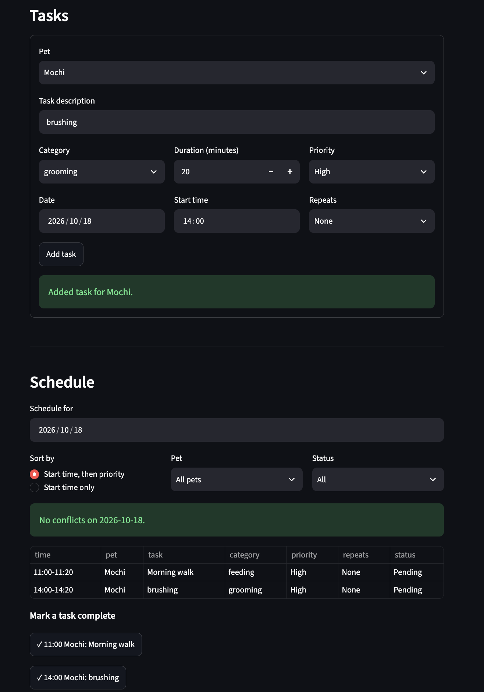

# PawPal+ (Module 2 Project)

You are building **PawPal+**, a Streamlit app that helps a pet owner plan care tasks for their pet.

## Scenario

A busy pet owner needs help staying consistent with pet care. They want an assistant that can:

- Track pet care tasks (walks, feeding, meds, enrichment, grooming, etc.)
- Consider constraints (time available, priority, owner preferences)
- Produce a daily plan and explain why it chose that plan

Your job is to design the system first (UML), then implement the logic in Python, then connect it to the Streamlit UI.

## What you will build

Your final app should:

- Let a user enter basic owner + pet info
- Let a user add/edit tasks (duration + priority at minimum)
- Generate a daily schedule/plan based on constraints and priorities
- Display the plan clearly (and ideally explain the reasoning)
- Include tests for the most important scheduling behaviors

## Getting started

### Setup

```bash
python -m venv .venv
source .venv/bin/activate  # Windows: .venv\Scripts\activate
pip install -r requirements.txt
```

### Suggested workflow

1. Read the scenario carefully and identify requirements and edge cases.
2. Draft a UML diagram (classes, attributes, methods, relationships).
3. Convert UML into Python class stubs (no logic yet).
4. Implement scheduling logic in small increments.
5. Add tests to verify key behaviors.
6. Connect your logic to the Streamlit UI in `app.py`.
7. Refine UML so it matches what you actually built.

## 🖥️ Sample Output

Paste a sample of your app's CLI or Streamlit output here so a reader can see what a generated plan looks like:

```
Today's Schedule for Darren - Monday, October 12, 2026
============================================================
07:30 AM - 08:00 AM  Morning walk         (Buddy, walk, high priority)
08:00 AM - 08:10 AM  Breakfast            (Whiskers, feeding, high priority)
12:30 PM - 12:35 PM  Thyroid medication   (Whiskers, medication, high priority)
06:00 PM - 06:20 PM  Grooming brush-out   (Buddy, grooming, low priority)
```

## Implementation Summary

PawPal is a pet-care scheduler. The logic is in pawpal_system.py. It can be driven from main.py, the Streamlit app.py, or tests.

|                 Class                  |                                                                                                                                                                 Role                                                                                                                                                                  |
| :------------------------------------: | :-----------------------------------------------------------------------------------------------------------------------------------------------------------------------------------------------------------------------------------------------------------------------------------------------------------------------------------: |
| Category, Priority, Recurrence (enums) |                                                          Category has seven task types. Priority is an IntEnum (LOW=1 to HIGH=3), so priorities compare and sort numerically. Recurrence is NONE, DAILY or WEEKLY, and its interval property returns the matching timedelta.                                                          |
|                  Task                  | One care activity, with a start_time, a duration_minutes, a priority, a category and a completed flag. It validates that the duration is positive and coerces category and priority to their enums. It has a derived end_time, mark_complete() and reschedule(). next_occurrence() returns a copy shifted by the recurrence interval. |
|                  Pet                   |                                       Owns a list of Tasks. add_task rejects a task whose pet_id doesn't match or whose task_id is a duplicate. It also has remove_task and get_pending_tasks. complete_task marks a task done and, if it recurs, appends the next occurrence with a fresh ID.                                        |
|                 Owner                  |                                                                                    Owns a list of Pets and a cache of schedules by date. It validates the email and rejects duplicate pet IDs. get_schedule(day) builds a new Schedule each time.                                                                                     |
|                Schedule                |                                                                      The plan for one day. generate(owner) collects every pending task, across all of the owner's pets, that starts on that day. It also has add_entry, detect_conflicts and get_ordered_tasks.                                                                       |

### How they work together

Ownership chain: Owner → Pet → Task. Each Task stores its pet_id and Pet.add_task checks it, so a task can't be attached to the wrong pet.

1. Schedules are derived, not stored as the source of truth. Owner.get_schedule(day) creates a Schedule and calls generate(self). That walks owner.pets → pet.get_pending_tasks() and filters to tasks starting that day. Because it rebuilds each time, the schedule can't go stale after a task is edited, completed or rescheduled. The schedules dict is only a cache of the last result.

2. Recurrence: a recurring task gets a series_id when it is added to a pet. Pet.ensure_occurrences(horizon) uses dataclasses.replace to copy each series' latest task forward one day or week at a time, up to a rolling HORIZON_DAYS (7) window. Each copy gets a new ID (max existing ID + 1) and completed=False, and skips times that are in the past or already exist. Owner.get_schedule calls it for every pet, and Pet.complete_task calls it too after marking a task done (using Task.next_occurrence to find the next instance), so upcoming days are already filled in and repeated calls never create duplicates.

3. Ordering: get_ordered_tasks() sorts by start time. Ties go to higher priority, then to lower task_id.

4. Conflict detection: detect_conflicts() does a sweep over tasks sorted by start time. It keeps a list of tasks still running and pairs each new task with any whose end_time is later than the new task's start. Windows are half-open, so back-to-back tasks don't conflict. It runs in O(n log n + overlaps) instead of comparing every pair. It checks across all pets, because one owner can't do two things at once.

## 🧪 Testing PawPal+

The suite lives in `tests/test_pawpal.py` and has 26 tests covering the scheduling behaviors that matter most:

- **Task and pet basics:** marking a task complete changes its status, and adding tasks to a pet grows its task list.
- **Recurring tasks (completion):** completing a daily task creates a new pending task exactly one day later (a weekly task, one week later), with a new ID and the same time of day. Non-recurring tasks create nothing, and completing the same task twice never creates a duplicate. An overdue recurring task rolls forward in whole intervals to the next future time. If the next instance was already created ahead of time, completing returns it instead of adding another.
- **Recurring tasks (rolling window):** adding a recurring task starts a series (`series_id`); non-recurring tasks get none. `ensure_occurrences` fills a series with one pending instance per interval through the horizon, skips times in the past, ignores non-recurring tasks, and is idempotent, so a second call with the same horizon creates nothing. Completing a task tops the window up to today + `HORIZON_DAYS`. `get_schedule` shows upcoming instances of a never-completed daily task, and days beyond the 7-day window stay empty.
- **Sorting:** tasks added out of order, across multiple pets, come back in chronological order from both `sort_by_time()` and `get_ordered_tasks()`.
- **Conflict detection:** overlapping tasks are flagged for different pets and for the same pet, and tasks at an identical start time are flagged. Three tasks at the same time produce all three pairs, and back-to-back tasks are not flagged.
- **Schedule edge cases:** completed tasks stay in a generated schedule so `filter_tasks(completed=True)` works, and a task that runs past midnight appears on the next day's schedule and conflicts with an early task there.
- **Error handling:** completing a task that doesn't belong to the pet raises `ValueError` and changes nothing.

```bash
# Run the full test suite:
python -m pytest

# Run with coverage:
pytest --cov
```

Sample test output:

```
============================================================================================= test session starts =============================================================================================
platform darwin -- Python 3.12.4, pytest-9.1.1, pluggy-1.6.0
rootdir: /Users/ddbutler/Desktop/Codepath/ai_eng/ai110-module2show-pawpal-starter
plugins: anyio-4.15.1
collected 26 items                                                                                                                                                                                            

tests/test_pawpal.py ..........................                                                                                                                                                         [100%]

============================================================================================= 26 passed in 0.04s ==============================================================================================
```

My confidence level for this system is 4 oout of 5 stars. Test cases pass expected behavior and end to end testing with the UI behaves as expected. However, future extensions could break behavior or there may be edge cases unaccounted for.

## 📐 Smarter Scheduling

All of these live in `pawpal_system.py`. The scheduling methods are on `Schedule` (the plan for one day); recurrence is on `Task` and `Pet`.

| Feature                    | Method(s)                                    | Notes                                                                                                                                      |
| -------------------------- | -------------------------------------------- | ------------------------------------------------------------------------------------------------------------------------------------------ |
| Sorting (in place)         | `Schedule.sort_by_time()`                    | Reorders `entries` by `start_time` and returns them. Stable, so equal start times keep their existing order. O(n log n).                   |
| Sorting (display order)    | `Schedule.get_ordered_tasks()`               | Returns a new sorted list without changing `entries`. Ties go to higher priority, then lower `task_id`.                                    |
| Filtering                  | `Schedule.filter_tasks(owner, completed, pet_name)` | Filter by completion status, pet name, or both. A filter left as `None` is ignored. Pet names match case-insensitively; an unknown name returns an empty list. |
| Conflict detection         | `Schedule.detect_conflicts()`                | Sorts by start time, then sweeps once, keeping only the tasks still running. Returns every overlapping pair in O(n log n + overlaps). Windows are half-open, so back-to-back tasks don't conflict. Checks across all pets and covers identical start times. |
| Conflict warnings          | `Schedule.conflict_warnings(owner)`          | Turns each conflicting pair into a readable message, marked "both for Buddy" (same pet) or "Buddy vs Whiskers" (different pets). Returns a list instead of raising, so a conflict never crashes the app. `app.py` shows each one with `st.warning`. |
| Recurring tasks            | `Pet.ensure_occurrences(horizon)`, `Pet.complete_task(task)`, `Task.next_occurrence(new_id)` | A `DAILY` or `WEEKLY` task becomes a series (`series_id`). `ensure_occurrences` creates its future instances up to a rolling `HORIZON_DAYS` (7) window, skipping past times and ones that already exist, so it is safe to call repeatedly. `Owner.get_schedule` calls it for every pet. `complete_task` marks the task done, returns the next occurrence (new or already created), and tops up the window. Instances keep the original time of day. Completing the same task twice returns `None` and creates no duplicate. |

### Example

```python
schedule = owner.get_schedule(today)

schedule.sort_by_time()                                    # earliest first
schedule.filter_tasks(owner, completed=False, pet_name="Buddy")  # Buddy's pending tasks
schedule.conflict_warnings(owner)                          # ["Warning: 'Vet visit' (03:00 PM-03:30 PM) overlaps 'Playtime' ... [Buddy vs Whiskers]"]
buddy.complete_task(task)                                  # also creates tomorrow's task if it recurs
```

`python main.py` runs each of these on sample data, including tasks added out of order and tasks at the same time.

## Features

- **Sorting by time**: `sort_by_time()` orders a day's tasks by start time. The sort is stable, so tasks that start together keep their existing order. The UI's "Start time only" option uses it.
- **Priority-aware ordering**: `get_ordered_tasks()` sorts by start time. Ties go to the higher priority, then to the lower task ID. This is the UI's default sort.
- **Conflict warnings**: `detect_conflicts()` sweeps the tasks in start order and keeps only those still running, so it costs O(n log n + overlaps) rather than comparing every pair.
  - It checks across all pets, because the owner can only do one thing at a time.
  - Windows are half-open, so back-to-back tasks are not conflicts.
  - Completed tasks are ignored.
  - `conflict_warnings()` turns each overlapping pair into a readable message ("both for Buddy" or "Buddy vs Whiskers") and never raises.
  - The app also rechecks the day right after you add a task.
- **Daily and weekly recurrence**: a task set to repeat becomes a series, and its future instances are created ahead of time for a rolling 7-day window (`HORIZON_DAYS`).
  - The window is topped up whenever a schedule is built and whenever a recurring task is completed.
  - Each instance keeps the original time of day and gets a fresh task ID.
  - Times already in the past are skipped, and instances that already exist are never duplicated, so repeated calls are safe.
  - Completing a recurring task marks only that instance done and returns the next one. Completing the same task twice does nothing.
- **Filtering**: `filter_tasks()` narrows the schedule by pet name (case-insensitive), by status (Pending or Done), or both. It never changes the underlying schedule.
- **Always-fresh daily schedule**: `Owner.get_schedule(day)` rebuilds the schedule from current tasks each time, so it is never stale. It includes completed tasks, and tasks that start the previous evening and run past midnight.
- **Input validation**: the code rejects non-positive durations, negative pet ages, emails without "@", duplicate pet or task IDs, and tasks added to the wrong pet.


## 📸 Demo Walkthrough

Run the app with `streamlit run app.py`. The page is laid out top to bottom, so you can follow it in order.

### The main UI features

1. **Owner:** edit the owner's name at the top of the page.
2. **Pets:** the "Add pet" form takes a name, species (dog, cat, other) and age. Added pets appear in a table below it.
3. **Tasks:** once there is at least one pet, the "Add task" form lets you pick the pet, then set a description, category, duration (1-240 minutes), priority, date, start time, and whether it repeats (None, Daily, Weekly). Invalid input shows an error instead of crashing.
4. **Schedule:** pick a day to see that day's plan. You can sort by "Start time, then priority" or "Start time only", filter by pet and by status (All, Pending, Done), and mark a pending task complete with its ✓ button.

### An example workflow

1. Add a pet: enter "Mochi", choose dog, age 3, and click **Add pet**. Mochi appears in the pets table.
2. Add a daily task: choose Mochi, enter "Morning walk" (walk, 30 minutes, High priority), set today's date and a start time of 7:30 AM, set **Repeats** to Daily, and click **Add task**.
3. Add a second task that overlaps it: for example "Breakfast" (feeding, 10 minutes) at 7:45 AM. A conflict warning appears right away.
4. View today's schedule in the **Schedule** section. The tasks appear in time order with the conflict banner above the table.
5. Change the day to tomorrow. Because the walk repeats, it is already listed there, up to 7 days ahead.
6. Click ✓ on the walk. A toast confirms it is done and names the next occurrence. Set **Status** to Done to see it in the filtered table.

### Scheduler behaviors you can see

1. **Sorting:** the table follows the chosen sort mode. Ties at the same start time go to the higher priority first.
2. **Conflict warnings:** overlapping tasks are listed under a red banner ("N scheduling conflict(s)"), each marked "both for Mochi" or "Mochi vs Luna". Back-to-back tasks are not flagged, and the banner always covers the whole day, even when the table is filtered.
3. **Filtering:** pet and status filters narrow the table without changing the schedule.
4. **Recurrence:** daily and weekly tasks show up on upcoming days without being re-entered, and completing one never creates a duplicate.

### Sample CLI output

`python main.py` runs the same logic on sample data. It shows sorting, each filter, and conflict detection, first with no overlaps and then after adding tasks that share a start time:

```
Today's Schedule for Darren - Sunday, October 18, 2026
============================================================

Entries as generated (insertion order)
------------------------------------------------------------
  06:00 PM - 06:20 PM  Grooming brush-out   (Buddy, pending)
  07:30 AM - 08:00 AM  Morning walk         (Buddy, pending)
  12:30 PM - 12:35 PM  Thyroid medication   (Whiskers, pending)
  08:00 AM - 08:10 AM  Breakfast            (Whiskers, pending)

sort_by_time()
------------------------------------------------------------
  07:30 AM - 08:00 AM  Morning walk         (Buddy, pending)
  08:00 AM - 08:10 AM  Breakfast            (Whiskers, pending)
  12:30 PM - 12:35 PM  Thyroid medication   (Whiskers, pending)
  06:00 PM - 06:20 PM  Grooming brush-out   (Buddy, pending)

filter_tasks(completed=False)
------------------------------------------------------------
  08:00 AM - 08:10 AM  Breakfast            (Whiskers, pending)
  12:30 PM - 12:35 PM  Thyroid medication   (Whiskers, pending)
  06:00 PM - 06:20 PM  Grooming brush-out   (Buddy, pending)

filter_tasks(completed=True)
------------------------------------------------------------
  07:30 AM - 08:00 AM  Morning walk         (Buddy, done)

filter_tasks(pet_name='whiskers')
------------------------------------------------------------
  08:00 AM - 08:10 AM  Breakfast            (Whiskers, pending)
  12:30 PM - 12:35 PM  Thyroid medication   (Whiskers, pending)

filter_tasks(completed=False, pet_name='Buddy')
------------------------------------------------------------
  06:00 PM - 06:20 PM  Grooming brush-out   (Buddy, pending)

filter_tasks(pet_name='Nobody')
------------------------------------------------------------
  (none)

Conflict check (no overlaps expected)
------------------------------------------------------------
  No conflicts.

Conflict check after adding same-time tasks
------------------------------------------------------------
  Warning: 'Teeth brushing' (10:00 AM-10:10 AM) overlaps 'Training' (10:00 AM-10:15 AM) [both for Buddy]
  Warning: 'Vet visit' (03:00 PM-03:30 PM) overlaps 'Playtime' (03:00 PM-03:20 PM) [Buddy vs Whiskers]
```

**Screenshot or video** _(optional)_: <!-- Insert a screenshot or link to a demo video here -->
