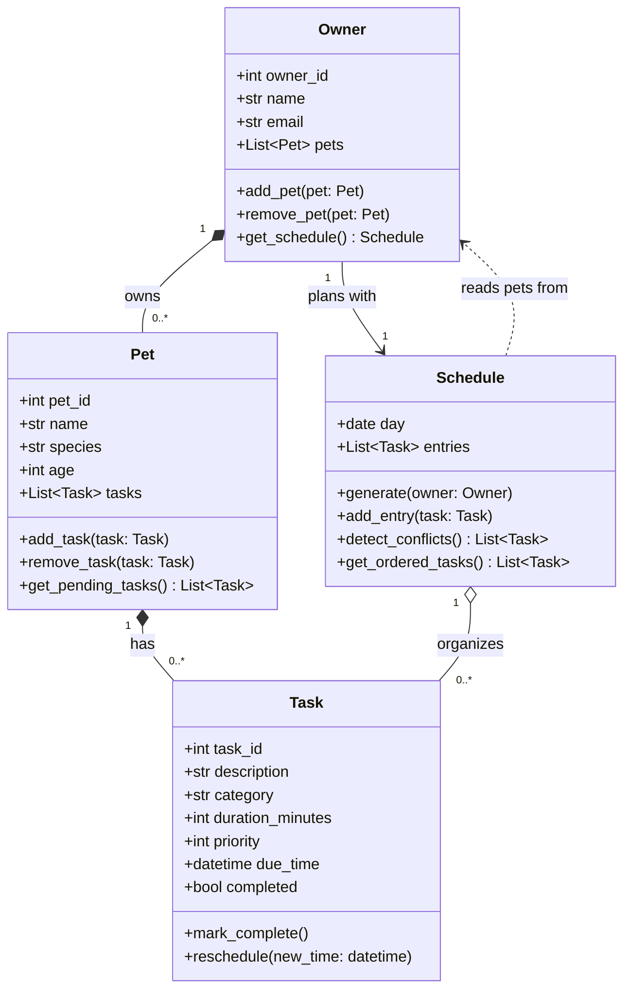

# PawPal+ Project Reflection

## 1. System Design

**a. Initial design**

- Briefly describe your initial UML design.
  - Before prompting an LLM, I identified the objects in the prompt. The objects include Owner, Pet, Task, and Schedule. I think an Owner would have a name and Pets attributes. Pets would have a name, breed, species and Owners attribute. Tasks would have a duration, priority, and Schedule attributes. Schedule would have a tasks, pet, and owner attribute. Pets can have multiple owners. Owners can have multiple pets. Tasks can belong to one schedule. Schedule can have multiple tasks for the owner. I've decided because owners can have multiple pets, that each task should correspond to one pet.

- What classes did you include, and what responsibilities did you assign to each?
  - I included classes for Owner, Pet, Task, and Schedule. Owners is responsible for holding information about Owners such as their name and the Pets they own. Pets is responsible for structuring information about pets including name, species, breed, the owner they belong to, and their schedule. Schedule is storing tasks and the pet the schedule belongs to. Task is responsible for tracking the duration and priority of the task.

**b. Design changes**

- Did your design change during implementation?
- If yes, describe at least one change and why you made it.

*TLDR: I decided to change the structure so the owner owns the schedule such that the owner is not double booked with tasks for different pets at the same time.*

Now, I'm going to prompt the LLM to see if it has any suggestions on my idea with with the following prompt.

Design a UML class diagram for an app that helps a pet owner plan care tasks for their pet with Owner, Pet, Task, and Schedule classes. Explain the relationships. Provide the UML diagram as Mermaid.js code.

The LLM gave me the following

> Design a UML class diagram for an app that helps a pet owner plan care tasks for their pet with Owner, Pet, Task, and Schedule classes. Explain the relationships. Provide the UML diagram as Mermaid.js code.

The suggestion revealed a tension I was experiencing between the realtionship of owner and schedule. The instructions and example output suggest that the schedule should belong to a pet so I designed the architecture for that, but I was bothered by the idea. If an owner has multiple pets, then pet schedules might conflict. Assuming the owner is accomplishing tasks, then it would be more appropriate for the schedule to belong to the owner and each task belong to a pet to more easily prevent task conflicts in the schedule followed by an owner. There's also the case that there could be multiple owners for a single pet and a task could be assinged to an owner and a pet, but for the sake of simplicity I'm going to assume that this app is meant to be used by a single person rather than a care team or each pet has one active care person assinged at a time.

The LLM gave me the following:

## Relationships

- **Owner → Pet (composition, 1 to 0..\*)**: An owner has any number of pets. Pets belong to one owner in this app, so they are removed with the owner.
- **Pet → Task (composition, 1 to 0..\*)**: Each task is created for a specific pet (feeding, walk, vet visit, medication). A task has no meaning without its pet.
- **Schedule → Task (aggregation, 1 to 0..\*)**: A schedule groups tasks into an ordered daily plan. Tasks exist independently of any schedule and can be moved between schedules or dropped from one without being deleted.
- **Owner → Schedule (association)**: The owner uses one schedule to plan care across all their pets.
- **Schedule ⇢ Owner (dependency)**: `generate()` takes an owner and pulls tasks from all of the owner's pets. The schedule uses the owner but doesn't hold a permanent reference to it.

## Design notes

- `Task` holds the data (duration, priority, due time), while `Schedule` holds the logic (ordering, conflict detection). This keeps scheduling rules in one place.
- `Pet` owns its tasks, and `Schedule` only references them. This avoids duplicate task data and keeps completion status consistent everywhere.

I haven't written this into [reflection.md](reflection.md) or the repo's UML file. If you want it saved, I can add it to either.

---

---

## 2. Scheduling Logic and Tradeoffs

**a. Constraints and priorities**

- What constraints does your scheduler consider (for example: time, priority, preferences)?
- How did you decide which constraints mattered most?

**b. Tradeoffs**

- Describe one tradeoff your scheduler makes.
- Why is that tradeoff reasonable for this scenario?

---

## 3. AI Collaboration

**a. How you used AI**

- How did you use AI tools during this project (for example: design brainstorming, debugging, refactoring)?
- What kinds of prompts or questions were most helpful?

**b. Judgment and verification**

- Describe one moment where you did not accept an AI suggestion as-is.
- How did you evaluate or verify what the AI suggested?

---

## 4. Testing and Verification

**a. What you tested**

- What behaviors did you test?
- Why were these tests important?

**b. Confidence**

- How confident are you that your scheduler works correctly?
- What edge cases would you test next if you had more time?

---

## 5. Reflection

**a. What went well**

- What part of this project are you most satisfied with?

**b. What you would improve**

- If you had another iteration, what would you improve or redesign?

**c. Key takeaway**

- What is one important thing you learned about designing systems or working with AI on this project?
