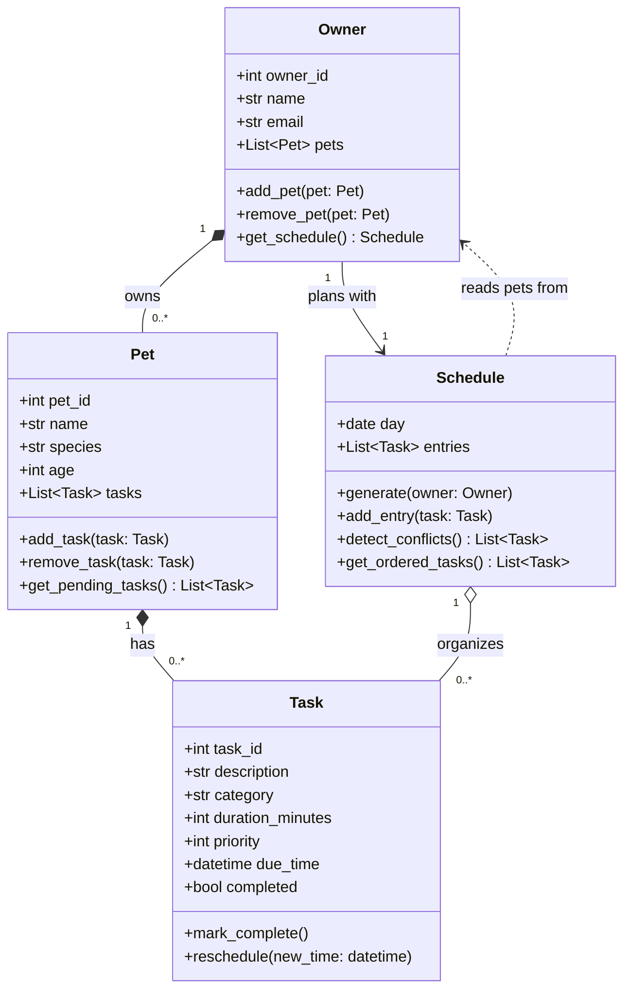

# PawPal+ Project Reflection

## 1. System Design

### **a. Initial design**

- Briefly describe your initial UML design.
- What classes did you include, and what responsibilities did you assign to each?
  - Before prompting an LLM, I identified the objects in the prompt. The objects include Owner, Pet, Task, and Schedule. I think an Owner would have a name and Pets attributes. Pets would have a name, breed, species and Owners attribute. Tasks would have a duration, priority, and Schedule attributes. Schedule would have a tasks, pet, and owner attribute. Pets can have multiple owners. Owners can have multiple pets. Tasks can belong to one schedule. Schedule can have multiple tasks for the owner. I've decided because owners can have multiple pets, that each task should correspond to one pet.
  - I included classes for Owner, Pet, Task, and Schedule. Owners is responsible for holding information about Owners such as their name and the Pets they own. Pets is responsible for structuring information about pets including name, species, breed, the owner they belong to, and their schedule. Schedule is storing tasks and the pet the schedule belongs to. Task is responsible for tracking the duration and priority of the task.
  - After prompting the 

### **b. Design changes**

- Did your design change during implementation?
- If yes, describe at least one change and why you made it.

#### *TLDR:* 

I decided to change the structure so the owner owns the schedule such that the owner is not double booked with tasks for different pets at the same time. When I asked about missing relationships, it revealed that...

Some missing relationships were:

- There was no attribute to link task to pet to task.
- There was no schedule field to link owner and schedule.
- It recommended including a recurrence field for the task class.
- It recommended changing data types of category to enum to prevent misspelling and specifying a documented range for priority.

I handled the following fixes.

##### Fix 1: pet_id on Task

I added pet_id to task so the Pet and Task class are appropriately linked such that each pet has tasks associated with it. The intial version left out the pet_id which caused a missing realtionship. Also, adding the field wasn't enough on its own. Nothing stopped someone from adding a task with pet_id=99 to pet 10, which would silently break the link. So Pet.add_task now raises ValueError on a mismatch and otherwise appends. I used an ID instead of a Pet object reference to avoid a circular Pet ↔ Task reference, which would make repr recurse forever.

##### Fix 2: clear start_time and end_time
The original due_time field was ambiguous: it could mean a deadline or a start time. I renamed it to start_time so it unambiguously means when the task begins. Also, I made end_time a derived property, instead of a stored field, so it can never disagree with duration_minutes after reschedule. The UML marks it "(derived)". This helps reduce schedule conflict.

##### Fix 3: day filter in Schedule.generate
generate originally pulled in every pending task, so a schedule for Tuesday would include tasks from every other day. It now rebuilds entries from scratch and keeps only pending tasks that start on the schedule's day. Rebuilding makes it safe to call twice without duplicating tasks.

##### Fix 4: Owner holds one schedule per day
The skeleton had Owner.get_schedule() with no day, even though a Schedule belongs to a single day. get_schedule(day) now takes a day, rebuilds the schedule from current tasks, and stores it in Owner.schedules. Rebuilding every time means a rescheduled or completed task never leaves a stale schedule behind. This also keeps the schedule owned by the owner, so tasks for different pets are checked against each other.

##### Fix 5: Recurrence on Task
A task had one start time and a completed flag, so a "feed daily" task would be finished forever after one completion. I added a Recurrence enum (none, daily, weekly). Completing a recurring task through Pet.complete_task creates the next occurrence as a new task, which keeps the completed one in history.

##### Fix 6: Enums for category and priority
Category was a free string, so "walk" and "Walk" were different, and priority was a bare int with no meaning. Category is now an enum, and Priority is an IntEnum (LOW=1, MEDIUM=2, HIGH=3, higher means more urgent). Invalid values now raise an error instead of silently being accepted.

##### Fix 7: Conflict detection and ordering
detect_conflicts returned a flat list of tasks, which doesn't say which tasks clash. It now returns the overlapping pairs, checked across all pets, because the owner can only do one thing at a time. It sorts by start time and sweeps instead of comparing every pair, which is O(n log n) rather than O(n squared). get_ordered_tasks now has a stated rule: start time first, then higher priority, then lower task_id.

##### Fix 8: Identity and validation
Removing a task or pet compared every field, so two identical-looking tasks were treated as the same. Removal and duplicate checks now go by task_id and pet_id, and adding a duplicate raises an error. I also added basic validation: duration must be positive, age can't be negative, and email must contain an @.

#### Round 1

Now, I'm going to prompt the LLM to see if it has any suggestions on my idea with with the following prompt.

Design a UML class diagram for an app that helps a pet owner plan care tasks for their pet with Owner, Pet, Task, and Schedule classes. Explain the relationships. Provide the UML diagram as Mermaid.js code.

The LLM gave me the following

> Design a UML class diagram for an app that helps a pet owner plan care tasks for their pet with Owner, Pet, Task, and Schedule classes. Explain the relationships. Provide the UML diagram as Mermaid.js code.

The suggestion revealed a tension I was experiencing between the realtionship of owner and schedule. The instructions and example output suggest that the schedule should belong to a pet so I designed the architecture for that, but I was bothered by the idea. If an owner has multiple pets, then pet schedules might conflict. Assuming the owner is accomplishing tasks, then it would be more appropriate for the schedule to belong to the owner and each task belong to a pet to more easily prevent task conflicts in the schedule followed by an owner. There's also the case that there could be multiple owners for a single pet and a task could be assinged to an owner and a pet, but for the sake of simplicity I'm going to assume that this app is meant to be used by a single person rather than a care team or each pet has one active care person assinged at a time.

The LLM gave me the following:

## Relationships

- **Owner → Pet (composition, 1 to 0..\*)**: An owner has any number of pets. Pets belong to one owner in this app, so they are removed with the owner.
- **Pet → Task (composition, 1 to 0..\*)**: Each task is created for a specific pet (feeding, walk, vet visit, medication). A task has no meaning without its pet.
- **Schedule → Task (aggregation, 1 to 0..\*)**: A schedule groups tasks into an ordered daily plan. Tasks exist independently of any schedule and can be moved between schedules or dropped from one without being deleted.
- **Owner → Schedule (association)**: The owner uses one schedule to plan care across all their pets.
- **Schedule ⇢ Owner (dependency)**: `generate()` takes an owner and pulls tasks from all of the owner's pets. The schedule uses the owner but doesn't hold a permanent reference to it.

## Design notes

- `Task` holds the data (duration, priority, due time), while `Schedule` holds the logic (ordering, conflict detection). This keeps scheduling rules in one place.
- `Pet` owns its tasks, and `Schedule` only references them. This avoids duplicate task data and keeps completion status consistent everywhere.

I haven't written this into [reflection.md](reflection.md) or the repo's UML file. If you want it saved, I can add it to either.

#### Round 2

After asking the AI if there are missing relationships or potential bottlenecks.

---

## 2. Scheduling Logic and Tradeoffs

**a. Constraints and priorities**

- What constraints does your scheduler consider (for example: time, priority, preferences)?
- How did you decide which constraints mattered most?

**b. Tradeoffs**

- Describe one tradeoff your scheduler makes.
- Why is that tradeoff reasonable for this scenario?

---

## 3. AI Collaboration

**a. How you used AI**

- How did you use AI tools during this project (for example: design brainstorming, debugging, refactoring)?
- What kinds of prompts or questions were most helpful?

**b. Judgment and verification**

- Describe one moment where you did not accept an AI suggestion as-is.
- How did you evaluate or verify what the AI suggested?

---

## 4. Testing and Verification

**a. What you tested**

- What behaviors did you test?
- Why were these tests important?

**b. Confidence**

- How confident are you that your scheduler works correctly?
- What edge cases would you test next if you had more time?

---

## 5. Reflection

**a. What went well**

- What part of this project are you most satisfied with?

**b. What you would improve**

- If you had another iteration, what would you improve or redesign?

**c. Key takeaway**

- What is one important thing you learned about designing systems or working with AI on this project?
